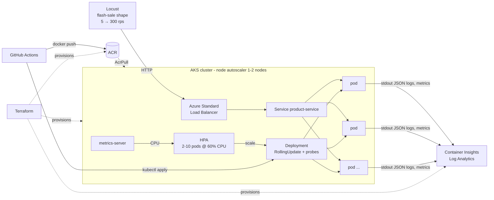

# Auto-Scaling Cloud Infrastructure for E-Commerce Flash Sales

A CPU-heavy Flask **Product Service** packaged with Docker, stored in a container registry, and run on managed
Kubernetes. A **Horizontal Pod Autoscaler** scales it out when Locust sends simulated flash-sale traffic and back in
when the sale ends, with no manual steps. Infrastructure is provisioned with **Terraform**. **GitHub Actions** builds
and deploys on every push.

The synopsis targets AWS. This implementation runs on **Azure**, because the EKS control plane charges
$0.10/h at all times, while AKS has a free control-plane tier and Azure for Students gives $100 of credit with no card.
Every AWS service in the synopsis has a direct Azure equivalent:

| Synopsis (AWS)                  | This repo (Azure)                                          | Where                          |
|---------------------------------|------------------------------------------------------------|--------------------------------|
| Amazon EKS                      | Azure Kubernetes Service (AKS), Free tier                  | `terraform/main.tf`            |
| Amazon ECR                      | Azure Container Registry (ACR), Basic                      | `terraform/main.tf`            |
| AWS Elastic Load Balancer       | Azure Standard Load Balancer (via `Service type=LoadBalancer`) | `k8s/20-service.yaml`      |
| Amazon CloudWatch               | Azure Monitor + Container Insights + Log Analytics         | `terraform/main.tf` (`oms_agent`) |
| AWS IAM                         | Microsoft Entra ID, managed identities, Azure RBAC, OIDC federation | `terraform/github-oidc.tf` |
| Kubernetes HPA / Metrics Server | Same (metrics-server is built into AKS)                    | `k8s/30-hpa.yaml`              |
| Terraform, GitHub Actions, Locust, Docker, Flask | Same                                      | —                              |

## Architecture



**The control loop being measured.** More requests mean more CPU per pod. metrics-server reports CPU, and when
average CPU goes over 60% of the pod's request, the HPA adds pods. The load balancer and kube-proxy spread traffic
across the new pods. If the new pods don't fit on the current nodes, the AKS cluster autoscaler adds a node. When the
sale ends, CPU falls, and after a 2-minute stabilisation window the HPA removes pods.

## Repository layout

```
app/                 Flask Product Service, unit tests, Dockerfile
k8s/                 Namespace, Deployment (probes, RollingUpdate, requests/limits), Service, HPA, PDB
terraform/           RG, ACR, Log Analytics, AKS (+ AcrPull), optional GitHub OIDC deploy identity
.github/workflows/   test → build → push to ACR → rolling deploy to AKS
loadtest/            Locust flash-sale traffic shape
analysis/            collect_metrics.py (pod/HPA/CPU sampler), plot_results.py (graphs + timings)
control-room/        Traffic slider + live 3D cluster view (live against AKS, or a calibrated simulation)
scripts/             deploy-azure.ps1 (manual deploy)
docs/                cost-analysis.md
```

### Product Service API

| Endpoint                          | Purpose                                                                 |
|-----------------------------------|-------------------------------------------------------------------------|
| `GET /products[?category=]`       | List the in-memory catalogue (15 items)                                 |
| `GET /products/<id>`              | One product                                                             |
| `GET /products/<id>/price?qty=n`  | Flash-sale price. **CPU-intensive**: `WORK_ITERATIONS` rounds of SHA-256 |
| `GET /healthz` / `GET /readyz`    | Liveness / readiness probes                                             |
| `GET /shop`                       | **Demo storefront**: product grid with live prices, plus a "Live infrastructure" bar showing which pod answers and every pod seen so far |
| `GET /whoami`                     | Pod name and version. The storefront polls it every 3 s                 |

**Demo tip:** open `http://<EXTERNAL-IP>/shop` on the projector while Locust runs. Gunicorn closes idle keep-alive
connections after 2 s, so each 3-second poll arrives on a new connection, and new pod names appear in the bar as the
HPA scales out.

Every response has an `X-Served-By: <pod-name>` header. Locust counts these, which shows how requests were spread
across pods (`*_served_by.csv`).

---

## 0. Prerequisites (Windows)

```powershell
winget install Microsoft.AzureCLI
winget install Hashicorp.Terraform
winget install Docker.DockerDesktop      # optional if you let GitHub Actions build images
az aks install-cli                       # installs kubectl
```

Activate **Azure for Students** (https://azure.microsoft.com/free/students) with your college email. Then run:

```powershell
az login
az account show --query id -o tsv        # subscription id for terraform.tfvars
```

## 1. Test locally (free)

```powershell
cd app
python -m venv .venv; .\.venv\Scripts\Activate.ps1
pip install -r requirements.txt pytest
pytest -q
python app.py                            # http://localhost:8080/products/101/price?qty=2
```

Quick smoke load test against the local server (1/10 duration, peak 30 users):

```powershell
cd loadtest; pip install -r requirements.txt
$env:TIME_SCALE="0.1"; $env:PEAK_USERS="30"
locust -f locustfile.py --host http://localhost:8080 --headless --csv ..\results\local --csv-full-history
```

**Optional local Kubernetes** (Docker Desktop → Settings → Kubernetes → Enable). Use this to practise HPA without
spending credit:

```powershell
docker build -t product-service:local app
kubectl apply -f https://github.com/kubernetes-sigs/metrics-server/releases/download/v0.7.2/components.yaml
kubectl patch deployment metrics-server -n kube-system --type=json `
  -p '[{"op":"add","path":"/spec/template/spec/containers/0/args/-","value":"--kubelet-insecure-tls"}]'
kubectl apply -f k8s/
kubectl -n flash-sale get svc product-service   # Docker Desktop exposes LoadBalancer on localhost:80
```

## 2. Provision Azure with Terraform

```powershell
cd terraform
copy terraform.tfvars.example terraform.tfvars   # fill in subscription_id and github_repo
terraform init
terraform plan
terraform apply                                  # ~5-8 min
terraform output
```

The region defaults to `indiasouthcentral`. On the MAHE student subscription, policy allows only five regions
(`az policy assignment list`), and `centralindia` marks every small VM size `NotAvailableForSubscription`. If
creation fails with `RequestDisallowedByPolicy`, set `location` to an allowed region and apply again. Before you
pick a region, check that it offers the VM size:
`az vm list-skus -l <region> --size Standard_B2s --resource-type virtualMachines`. If apply fails with a vCPU quota
error, keep `node_max_count = 2`.

**Budget alert.** Set `budget_alert_emails` in `terraform.tfvars` and `apply` also creates a subscription budget
(`budget_amount`, default $10/month) that emails at 50% and 80% of actual spend and at 100% of forecast. It is
scoped to the subscription because AKS puts its VMs and load balancer in a separate `MC_*` resource group.

## 3. Deploy

**Option A: GitHub Actions (recommended).** Push this folder to a GitHub repo. Then go to *Settings → Secrets and
variables → Actions → Variables* and add every key/value from `terraform output github_actions_variables`
(`AZURE_CLIENT_ID`, `AZURE_TENANT_ID`, `AZURE_SUBSCRIPTION_ID`, `ACR_NAME`, `AKS_RESOURCE_GROUP`, `AKS_NAME`). Each
push to `main` that touches `app/` or `k8s/` runs the tests, builds the image, tags it with the commit SHA, pushes it to
ACR and does a rolling update on AKS. GitHub uses OIDC, so no Azure secret is stored.

**Option B: manual.** From the repo root:

```powershell
.\scripts\deploy-azure.ps1            # needs Docker Desktop
.\scripts\deploy-azure.ps1 -AcrBuild  # builds inside Azure; may be blocked on student subscriptions
```

Then check:

```powershell
kubectl -n flash-sale get pods,svc,hpa
$IP = kubectl -n flash-sale get svc product-service -o jsonpath="{.status.loadBalancer.ingress[0].ip}"
curl "http://$IP/products/101/price?qty=2" -i
```

## 4. Run the flash-sale experiment

Use two terminals.

```powershell
# Terminal 1 - sample HPA / pods / CPU / nodes every 5 s
python analysis/collect_metrics.py --out results/run1_k8s.csv

# Terminal 2 - 12-minute flash-sale shape (5 → 300 rps → hold → down → cool-down)
locust -f loadtest/locustfile.py --host "http://$IP" --headless --csv results/run1 --csv-full-history
```

You can watch scaling live with `kubectl -n flash-sale get hpa -w` and `kubectl get nodes -w`. After Locust ends,
wait until the pods return to 2, stop terminal 1, then run:

```powershell
python analysis/plot_results.py --locust results/run1_stats_history.csv --k8s results/run1_k8s.csv --out results/run1.png
```

This writes a 4-panel figure (req/s, latency, CPU vs the 60% target, desired/ready pods and nodes). It also prints the
**measured** scale-out reaction time, time until the first new pod is Ready, time to peak pods, scale-in time, peak
throughput and availability.

**Tuning.** 300 rps of `/price` needs more CPU than 10 pods × 500m. If latency or failures climb while the HPA is
already at `maxReplicas`, the cluster is at capacity. That is a valid result to report. To fit the run inside your
quota, lower `WORK_ITERATIONS` in `k8s/10-deployment.yaml` or lower `PEAK_USERS`. A fast laptop running Locust can
generate about 300 users. If Locust warns about high CPU, run it with `--processes 4`.

### Live 3D control room

For the presentation, [`control-room/`](control-room/README.md) has a traffic slider and a live 3D view of pods
filling up, the HPA scaling out, Pending pods and new nodes booting. Run it with
`python control-room/server.py --live --host http://$IP`. Without `--live` it runs a clearly labelled simulation,
calibrated to run2, for free rehearsal.

## 5. Availability & rolling-update demo

While a Locust run is holding steady load, start a new version:

```powershell
kubectl -n flash-sale set env deployment/product-service APP_VERSION=v2
kubectl -n flash-sale rollout status deployment/product-service
```

Because of `maxUnavailable: 0`, the readiness probes and the `preStop` drain, Locust's failure count should stay at
zero while `X-Served-By` moves to the new pods. To show the liveness probe working, run
`kubectl -n flash-sale delete pod <name>` and the pod is replaced automatically.

## 6. Monitoring (CloudWatch equivalent)

In the Azure Portal open the **AKS cluster → Monitoring → Insights**. It shows live node and pod CPU and memory and
the container logs. In **Logs** (Log Analytics) you can run:

```kusto
// Request log lines emitted by the service (JSON parsed)
ContainerLogV2
| where PodNamespace == "flash-sale"
| extend j = parse_json(LogMessage)
| where j.msg == "request"
| summarize requests = count(), p95_ms = percentile(todouble(j.latency_ms), 95) by bin(TimeGenerated, 30s), tostring(j.pod)
| render timechart

// Number of product-service pods over time
KubePodInventory
| where Namespace == "flash-sale" and PodStatus == "Running"
| summarize pods = dcount(Name) by bin(TimeGenerated, 1m)
| render timechart
```

(If `ContainerLogV2` is empty, your workspace uses the older schema. Query `ContainerLog` and `LogEntry` instead.)

## 7. Tear down (do this after every session)

```powershell
kubectl delete -f k8s/          # releases the load balancer public IP first
cd terraform; terraform destroy
```

Running cost is about $0.14/h (≈ $3.3/day) with 2 nodes. Destroying the environment between sessions makes the $100
student credit last the whole semester. See [docs/cost-analysis.md](docs/cost-analysis.md).
